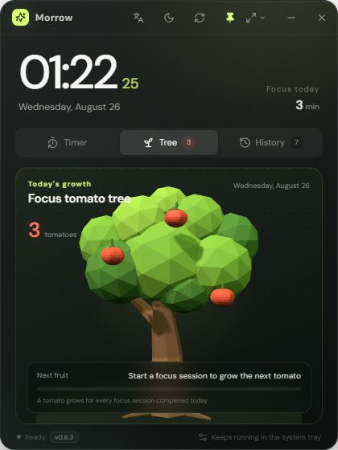

# Morrow Desk Clock

[简体中文](README.md) | English

A lightweight desktop clock and focus companion for Windows 11, built with Tauri 2, React, TypeScript, and Three.js—without Electron.

Current stable release: [`v0.6.12`](https://github.com/GrayJS/desk-clock/releases/latest)

v0.6.12 lets you skip focus or rest during a cycle while preserving the phase,
planned duration, elapsed time, and note. See the
[release notes](docs/releases/v0.6.12.md) or [full changelog](CHANGELOG.md).

## Preview



The screenshot illustrates the tree view; controls and layout may differ in the current release.

## Download and Install

1. Open [GitHub Releases](https://github.com/GrayJS/desk-clock/releases/latest).
2. Download the [v0.6.12 Windows x64 installer](https://github.com/GrayJS/desk-clock/releases/download/v0.6.12/Morrow._0.6.12_x64-setup.exe).
3. Run the installer and launch Morrow.

Windows 10/11 x64 and Microsoft Edge WebView2 are required. WebView2 is normally preinstalled on Windows 11.

Existing users can open Settings → Check for updates and confirm a silent upgrade.
Local history and settings are preserved.

## Features

- Live clock and date with always-on-top enabled by default
- Compact, standard, and expanded window presets with title-bar quick switching, free resizing, and dragging
- Compact mode keeps mode switching, countdown, start/pause, reset, and progress controls
- The Windows tray icon supports separate click and double-click actions plus custom PNG, JPG, or WebP icons
- Dark, light, and Windows system theme modes
- Instant Simplified Chinese and English switching
- Unified settings panel for appearance, window, startup, and update options
- A manual timer with focus and rest modes; completed focus sessions stay in focus mode until you start the next session
- Quick duration presets and custom 1–180 minute countdowns
- A third Cycle tab with 1–99 rounds and independent focus/rest durations that advance automatically
- Current goal, quick notes, and completed or skipped session history with confirmation before clearing records
- System tray background mode with restore and quit actions
- Optional start at login, synchronized with the actual Windows startup entry
- Deadline-based countdowns with optional completion notifications scheduled by native background tasks
- iOS-inspired frosted glass, dimensional clock digits, highlighted buttons, and press feedback with native Windows Mica and an Acrylic fallback

## Quick Start

In standard and expanded windows, the tabs appear in this order:

1. **Timer**: choose a focus or rest duration, enter a goal and optional note, then start timing.
2. **Tree**: see today's tomatoes and how the tree evolves with completed focus sessions.
3. **Cycle**: configure multiple focus rounds and rests that advance automatically.
4. **History**: review completed focus, skipped focus/rest phases, and notes; clearing requires confirmation.

A manual focus session records its completion and stops. A manual rest returns
to focus mode and also waits for a manual start. Complete this round records the
configured full focus duration, rather than the time actually elapsed.

## Settings

Open the unified settings panel with the gear button in the title bar. Changes
take effect immediately:

- **Appearance**: system, light, or dark theme and Simplified Chinese or English
- **Window**: compact, standard, or expanded size and always-on-top behavior
- **Windows tray**: configure separate tray-icon click and double-click actions for show main window, start/pause, reset, next mode, always on top, settings, or no action; a fresh installation defaults to single-click showing the main window and double-click opening Settings
- **System**: start at login, Windows timer notifications, and signed update checks

Always on top and window-size switching remain available as title-bar shortcuts;
the size button cycles through compact, standard, and expanded presets. Start at
login reads and updates the actual Windows login entry, so it is unavailable in
a regular browser-only frontend preview.

Custom tray icons accept PNG, JPG, or WebP files up to 2 MB. Images are scaled
proportionally and padded to 32×32. The tray's right-click menu provides Show main
window and Quit Morrow; both title-bar minimize and close hide the window to the
tray. Preferences carried over from an upgrade may differ from fresh-install
defaults; review or change them in Settings.

| Preset | Window size | Best for |
| --- | ---: | --- |
| Compact | 360×210 | Keeping the clock visible while controlling the timer |
| Standard | 420×600 | Everyday timing, goals, and focus history |
| Expanded | 720×520 | Side-by-side timer content or the full achievement tree |

Sizes are logical pixels; physical screen pixels depend on Windows display
scaling. The saved preset is restored at launch; exact dimensions from free
resizing are not saved separately. The title-bar size button reflects the current
preset, and its tooltip identifies the next preset.

Compact mode shows the clock and simplified timer controls rather than the four
tabs. Switch to standard or expanded mode to configure a cycle. During a cycle,
View cycle in compact mode opens the standard window's Cycle tab.

## Pomodoro Cycles

Open the third tab, Cycle, to choose 1–99 rounds and focus/rest durations of
1–180 minutes each. Press Start cycle. A fresh installation defaults to four
rounds with 25 minutes of focus and 5 minutes of rest. Cycle plans and manual
timer durations are saved separately; editing one does not change the other.

For example, **4 rounds with 25 minutes of focus and 5 minutes of rest** run four
focus periods and three rests, for **115 minutes** total. The cycle stops after
the final focus period.

- Automatically alternate focus and rest, stopping after the final focus without an extra rest
- Record each completed focus and grow a tomato; rests never create focus records
- Pause, resume, or end a cycle; its plan stays locked while running or paused, so end the run before editing it
- The normal timer, compact timer, and tray share the same start/pause and reset controls; reset restarts only the current phase and pauses it
- Complete this round on the Timer tab also advances the cycle; if paused, the next phase stays paused
- Skip the current focus or rest from the Cycle tab, normal timer, or compact timer; a running cycle continues to the next phase, while a paused cycle stays paused
- Skips retain the phase, planned duration, actual elapsed time, timestamp, and note as skipped records rather than completed rounds; skipping the final focus ends the cycle
- Skipped focus contributes its actual time to today's focus total without adding a completed round or tomato; skipped rests do not add focus time
- Mode and duration changes are locked during a cycle; View cycle in compact mode opens the standard window's Cycle tab
- Every phase follows the Windows notification preference; timing continues in the tray, and ending a cycle keeps completed focus records without recording the unfinished phase

If Start cycle is unavailable, pause and reset the manual timer, or finish its
current session, before starting a cycle.

Timing and cycles require the Morrow process to keep running. Pausing retains
progress for the current run; quitting does not restore remaining time, the
current round, or unfinished notes. Saved plans, completed records, and settings
remain available after restarting.

## Daily Focus Tomato Tree

- A low-poly achievement tree rendered with Three.js
- One tomato is added for every focus session completed that day
- Tree height, crown width, branches, and foliage density evolve with the tomato count using smooth transitions
- During a countdown, the next tomato grows from a small green fruit into a ripe red tomato
- Pausing preserves its current maturity; resetting or switching modes cancels that growth
- Tomato counts follow locally saved completed focus records for today; skips never add tomatoes, and a new local date starts a new tree without deleting history
- The scene displays at most 50 tomatoes to limit rendering cost; its count still reflects all saved focus records for today
- The tree includes breathing, swaying, pointer parallax, and responsive scaling animations

| Tomatoes today | Tree form |
| ---: | --- |
| 0–1 | Seedling |
| 2–4 | Sapling |
| 5–9 | Growing |
| 10–17 | Flourishing |
| 18+ | Harvest |

## Updates

- Checks for a signed update once after launch
- Checks for new versions every hour in the background
- Provides a manual update-check button in Settings
- Prompts when a new version is found, with Update now and Remind me later choices
- Downloads and installs silently only after confirmation; it never installs without approval
- Opens the manual download page only if automatic installation fails
- Reports when Morrow is up to date or when the network check fails
- Displays the current application version in the footer

## Data and Privacy

- Focus history, the current goal, durations, cycle plans, theme, language, window size, always-on-top, notification, and tray preferences stay in local `localStorage`
- The most recent 200 session records are kept, including completed focus and skipped focus/rest phases; older entries are removed automatically
- Daily focus time combines the planned duration of completed focus and actual elapsed time of skipped focus, displayed as whole minutes; tomatoes count only completed focus, and all totals use retained records
- Notes are saved when focus completes or a cycle phase is skipped; other unfinished notes exist only for the current run
- Clearing history removes all saved session records and updates daily totals and the tree; it does not clear the goal, cycle plan, or other settings
- Start at login is managed by the Windows login entry and is never uploaded to a remote service
- No account is required
- Focus history and quick notes are never uploaded
- The app does not send focus content, notes, or configuration to a server; network requests load Google Fonts and check or download updates through GitHub

## Development

Windows development requires:

- Node.js 20+ and npm
- Rust stable with the MSVC toolchain
- Microsoft C++ Build Tools with Desktop development with C++ and the Windows SDK
- Microsoft Edge WebView2 Runtime

See the [Tauri Windows prerequisites](https://v2.tauri.app/start/prerequisites/#windows).
Run the following commands from the repository root:

```powershell
npm ci
npm run tauri dev
```

To run only the frontend preview (without native tray, window controls, start at
login, Windows notifications, or silent updates):

```powershell
npm run dev
```

### Tests and Checks

Run these commands from the repository root:

```powershell
npm test
npm run build
cargo test --locked --manifest-path src-tauri/Cargo.toml
```

`npm test` covers phase order, skipping, the final round, plan isolation, input
bounds, elapsed time, and compatibility with older records.
The release workflow runs these tests before building the installer.

## Build the Installer

### Build for Local Installation

The repository enables updater signing by default. Without the release private
key, create an override file outside the repository, for example
`C:\morrow-build\local-build.json`, containing:

```json
{
  "bundle": {
    "createUpdaterArtifacts": false
  }
}
```

Then run from the repository root:

```powershell
npm run tauri build -- --config C:\morrow-build\local-build.json
```

This produces an NSIS installer for local use without an updater `.sig` file.
The output directory is:

```text
src-tauri/target/release/bundle/nsis/
```

### Publish an Updatable Release

Keep `createUpdaterArtifacts: true` and use the private key matching the public
key embedded in the app. For a local signed build, set `TAURI_SIGNING_PRIVATE_KEY`
and the corresponding `TAURI_SIGNING_PRIVATE_KEY_PASSWORD` in the current shell,
then run `npm run tauri build`. Putting them only in `.env` does not work; see
[Tauri's update signing guide](https://v2.tauri.app/plugin/updater/#signing-updates).

Align the app versions in `package.json`, `package-lock.json`,
`src-tauri/Cargo.toml`, `src-tauri/Cargo.lock`, and `src-tauri/tauri.conf.json`, then push the
matching `v*` tag. GitHub Actions runs the cycle logic tests before building the
release, and uploads the installer, updater verification signature (`.sig`), and
manifest (`latest.json`). CI reads the signing credentials from repository
secrets; keep private keys and their backups outside the repository.

## Project Structure

```text
src/                         React + TypeScript interface
src/components/SettingsPanel.tsx Unified settings panel
src/components/CyclePanel.tsx Cycle configuration, progress, and controls
src/components/FocusTree.tsx Three.js daily achievement tree
src/lib/pomodoroCycle.ts     Cycle plan validation and phase transitions
src/lib/                     Window, background notification, and updater helpers
src-tauri/src/lib.rs         Tauri tray, notification, and native window logic
tests/                       Cycle logic tests
docs/                        Preview screenshots and release notes
```

## Tech Stack

- Tauri 2
- React 18
- TypeScript
- Three.js
- Vite
- Rust

## License

This project is available under the [MIT License](LICENSE). You may use, modify,
and distribute it as long as the original copyright and license notice are kept.
